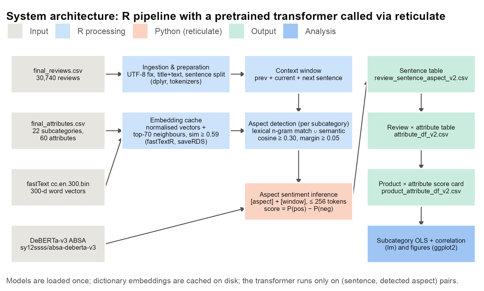
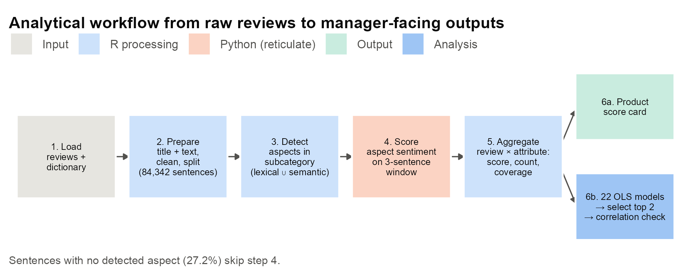
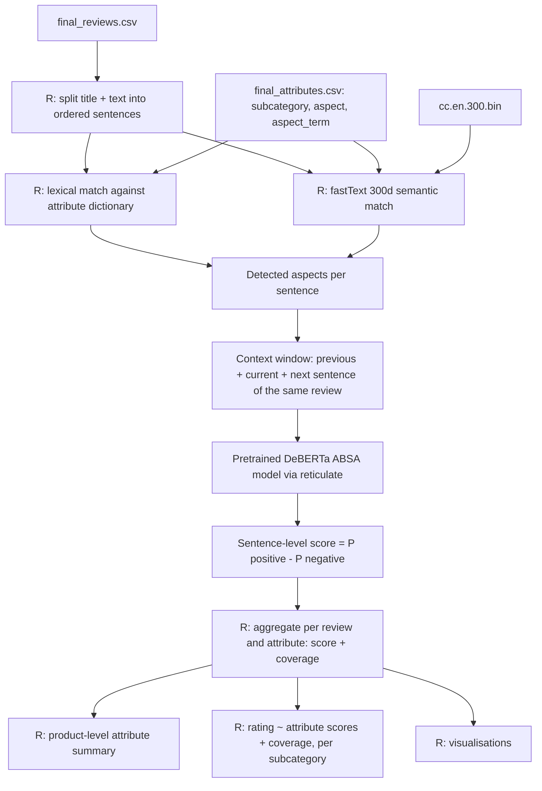
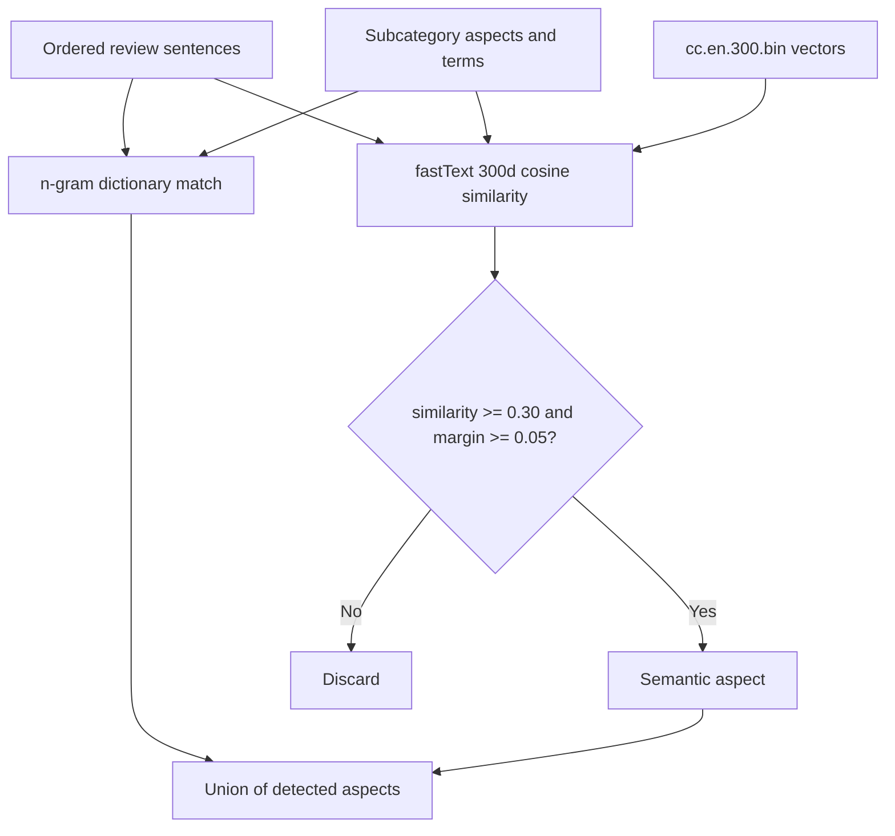

# Aspect-Based Sentiment Analysis (ABSA) of Amazon Electronics Reviews

## Project objective

A star rating tells you **how** satisfied a customer is, not **why**. This project reads Amazon Electronics reviews, detects which product attributes (aspects) each review discusses — battery, sound, fit, build quality, … — scores the sentiment toward **each attribute separately**, and then measures which attributes drive the star rating within a product subcategory.

Attributes are defined per subcategory (what matters for headphones is not what matters for phone cases), and whole sentences are kept intact so sentiment-bearing context such as negation and contrast is not lost.

## Architecture







## How it works

### 1. Text preparation (R)

Each review gets a `review_id`. Title and text are concatenated, invalid UTF-8 is dropped, and the result is split into ordered sentences with `tokenizers::tokenize_sentences`. HTML tags and extra whitespace are removed; negation and contrast words are kept.

### 2. Aspect detection (R)

`datasets/final_attributes.csv` maps each subcategory to its aspects and the terms customers use for them (e.g. `protection, fit, snug fit`). For every sentence, only the aspects of that review's subcategory are considered.

- **Lexical:** sentence n-grams (up to the longest dictionary phrase) are matched against aspect names and aspect terms.
- **Semantic:** remaining words (minus stop words and generic words listed in `FASTTEXT_IGNORE_WORDS`) are compared to the dictionary using cosine similarity of pretrained **fastText `cc.en.300.bin`** (300-dimensional) vectors. A word is assigned to an aspect when similarity is at least `0.30` and beats the next-best aspect by a margin of at least `0.05` (set in `main.R`). Nearest-neighbour terms of each aspect are also pre-computed.

Dictionary vectors and neighbour mappings are cached in `embeddings/*.rds` so they are computed only once.



### 3. Aspect-specific sentiment (Python model, called from R)

For every detected aspect, the sentence plus its previous and next sentence (only when they belong to the same review) is sent with the aspect name to the pretrained DeBERTa ABSA model [`sy12ssss/absa-deberta-v3`](https://huggingface.co/sy12ssss/absa-deberta-v3). The model is used for inference only — no training. Its negative / neutral / positive probabilities become a score:

```text
sentiment_score = P(positive) - P(negative)     # range -1 to +1
```

### 4. Aggregation (R)

- **Review × attribute** (`attribute_df`): `attribute_score` is the mean sentence score, `attribute_count` the number of sentences mentioning the attribute, and `attribute_coverage = attribute_count / total sentences in the review`.
- **Product × attribute** (`product_attribute_df`): mean sentiment plus counts of positive, neutral and negative reviews per product (`asin`) and attribute.

### 5. Regression and visualisations (R)

For each subcategory in `REGRESSION_SUBCATEGORIES` (currently `cables` and `peripherals`), an OLS model is fitted:

```text
rating ~ <attribute>_attribute_score + <attribute>_attribute_coverage   (for every attribute of the subcategory)
```

Unmentioned attributes get score 0 (neutral) and coverage 0. A pairwise correlation matrix of the predictors is printed as a multicollinearity check. Plots are written to `output/graphs/`.

## Repository layout

| Path | Purpose |
|---|---|
| `main.R` | Entry point: runs the full pipeline |
| `constants.R` | Required R packages / Python modules, model ID, fastText paths, regression subcategories |
| `setup.R` | Installs and loads R packages, selects the Python env, loads datasets |
| `utils.R` | Logger, review/sentence/attribute data frame builders, text cleaning |
| `models/bert_sentiments.R` | Loads DeBERTa and scores a sentence for one aspect |
| `processing/text_processing.R` | Sentence splitting, n-grams, lexical detection |
| `processing/semantic_matching.R` | fastText loading, caching and semantic detection |
| `processing/subcategory_regression.R` | Per-subcategory regression |
| `processing/visualizations.R` | Exploratory plots |
| `datasets/` | `final_reviews.csv` (30,740 reviews) and `final_attributes.csv` (attribute dictionary) |
| `embeddings/` | fastText model and caches — **not in git, see Setup** |
| `output/` | Pipeline outputs (`*_v2.csv`) and graphs |

## Setup

### 1. R

R packages are listed in `REQUIRED_PACKAGES` in `constants.R`; `setup.R` installs any that are missing and loads them.

### 2. Python

The DeBERTa model runs in Python through `reticulate`. You need a **virtualenv named `absa-env`** that `reticulate::use_virtualenv("absa-env")` can find, with these modules installed:

- `torch`
- `numpy`
- `transformers`

`setup.R` checks these on **every** run and stops if any is missing — including the quick run below.

### 3. Downloads (not included in the repository)

The `embeddings/` folder is gitignored, so it does not exist in a fresh clone.

1. Create the folder in the project root:
   ```bash
   mkdir embeddings
   ```
2. Download the English fastText vectors from the [fastText website](https://fasttext.cc/docs/en/crawl-vectors.html) — `cc.en.300.bin.gz` (about 4.5 GB):
   ```bash
   curl -O https://dl.fbaipublicfiles.com/fasttext/vectors-crawl/cc.en.300.bin.gz
   ```
3. Unzip it into `embeddings/` (about 7.2 GB on disk):
   ```bash
   gunzip cc.en.300.bin.gz && mv cc.en.300.bin embeddings/
   ```
   The path must match `FASTTEXT_PATH = "./embeddings/cc.en.300.bin"`. The model is loaded fully into memory, so make sure you have enough free RAM.

You do **not** need to download:

- `embeddings/fasttext_dictionary_cache.rds` and `embeddings/fasttext_neightbour_mapping_cache.rds` — these are built automatically on the first full run. If you edit `final_attributes.csv`, delete both files so they are rebuilt.
- The DeBERTa model — `transformers` downloads `sy12ssss/absa-deberta-v3` from Hugging Face on the first full run (internet required).

### 4. Working directory

`main.R` starts with a hard-coded `setwd("~/Downloads/NUS/Semester 1/Big Data/capstone project")`. Change this path to wherever you cloned the repository before running.

## Running

### Quick run — use the committed outputs

The `output/*_v2.csv` files are committed. When they exist, `main.R` loads them and skips aspect detection and sentiment inference, going straight to the regression and visualisations. This does **not** need the fastText file or the DeBERTa download, but it still needs the R packages and the `absa-env` Python environment.

```r
source("main.R")
```

### Full run — recompute everything

Complete all Setup steps, then increase `version` in `main.R` (e.g. `version = 3`). Since no `*_v3.csv` outputs exist yet, the full ABSA pipeline runs and writes new versioned outputs to `output/`.

```r
source("main.R")
```

The full run loops over every sentence and calls DeBERTa once per detected aspect, so expect it to take a long time.

## Outputs

| File | Grain | Contents |
|---|---|---|
| `output/review_sentence_aspect_v<N>.csv` | One row per sentence | `review_id`, `subcategory`, `asin`, `sentence`, and one column per aspect holding the sentence's sentiment score (empty if not mentioned) |
| `output/attribute_df_v<N>.csv` | Review × attribute | `attribute_score`, `attribute_count`, `attribute_coverage` |
| `output/product_attribute_df_v<N>.csv` | Product × attribute | Mean `sentiment`, total product reviews, reviews mentioning the attribute, and positive / neutral / negative review counts |
| `output/graphs/` | — | Exploratory and report figures |

## Course constraint

All work is done in R, except use of a pretrained BERT-family model from Python (via `reticulate`). The chosen model is DeBERTa, which is BERT-family rather than the original BERT, so confirm it is covered by this exception. Python is used only to load the pretrained model and run inference; all preprocessing, detection, aggregation, regression and plotting are in R.
