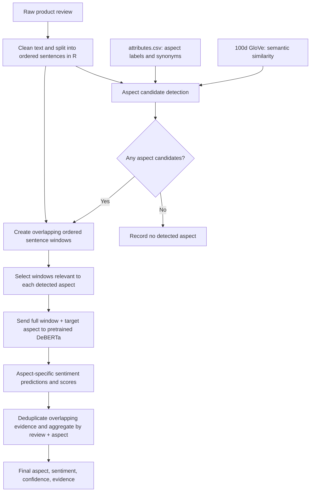
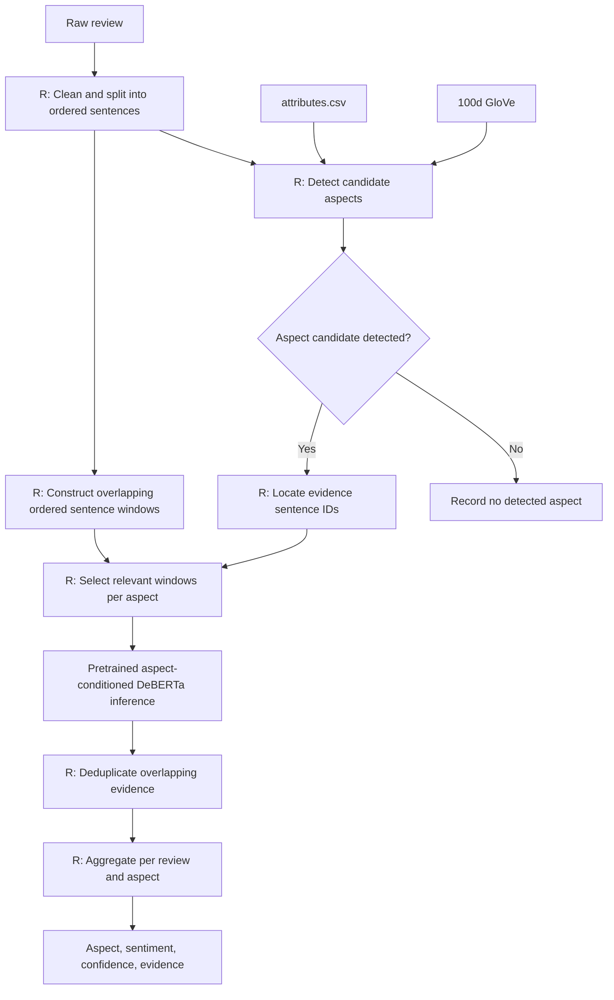
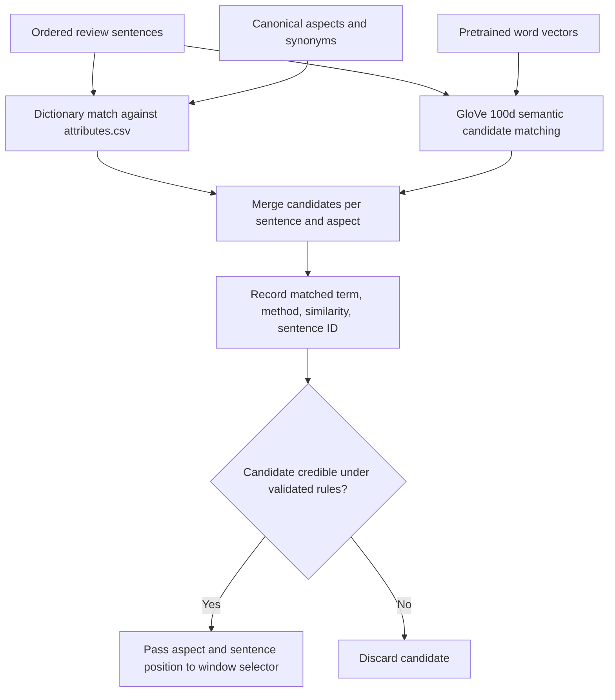
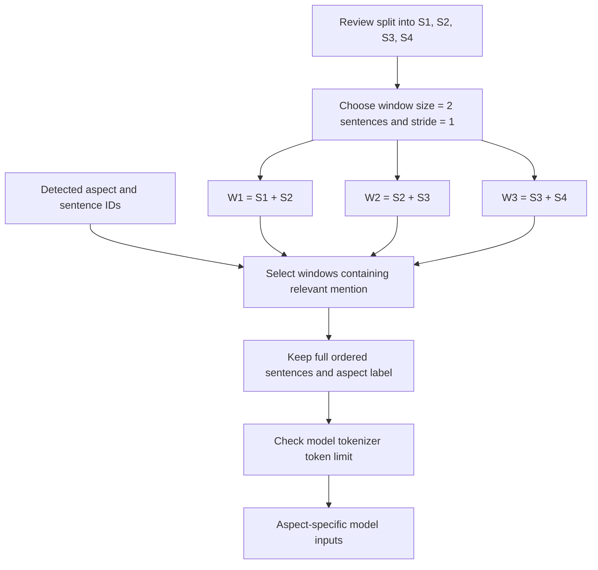
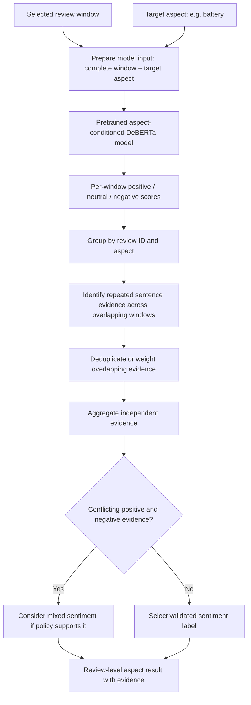

# Aspect Detection and Aspect-Based Sentiment Analysis (ABSA)

## Project objective

Identify product aspects discussed in customer reviews and determine the sentiment toward **each aspect**, rather than assigning one sentiment to the entire review.

The design preserves complete sentences and their order. It avoids clause-cutting and short extracted fragments because those can discard sentiment-bearing context (for example, identifying only `the battery` rather than `the battery drains incredibly quickly`).

## Final proposed architecture



## Why this design?

- **Dictionary + GloVe for aspect detection:** The dictionary catches explicit names and known synonyms; GloVe expands coverage to semantically related language. GloVe is not a sentiment classifier and cosine similarity alone does not prove that an aspect is present.
- **Whole sentences instead of clause fragments:** Preserve negation, comparisons, modifiers, and causal explanations.
- **Overlapping sentence windows:** A review may mention an aspect more than once; its sentiment may span adjacent sentences. Sliding windows preserve discourse context while staying within the model's token budget.
- **Aspect-specific DeBERTa:** The same window may contain several aspects with different sentiment. Run inference separately for each target aspect.
- **Evidence-aware aggregation:** Overlapping windows can repeat the same evidence; deduplicate or weight evidence before producing a review-level aspect label.

## Processing stages

### 1. Input and text preparation (R)

Input fields should include a stable `review_id` and `review_text`. Preserve the original text. Normalize whitespace conservatively, split into ordered sentences, and retain `sentence_id` and character offsets where feasible. Do not remove negation or contrast words such as *but*, *however*, and *whereas*.

### 2. Aspect candidate detection (R)

Read `attributes.csv` into an aspect-to-terms mapping. For each sentence, compare text with each aspect label and its known terms using case-insensitive, word-boundary-aware matching. For terms not matched directly, use pretrained 100-dimensional GloVe word vectors and cosine similarity to propose semantically related mentions. For multiword phrases, define a consistent pooling method and test it on held-out examples.

Candidate output:

| review_id | sentence_id | aspect | detection_method | similarity |
|---|---:|---|---|---:|
| R001 | 2 | battery | dictionary | NA |
| R001 | 3 | camera | GloVe | 0.78 |

**Important:** The similarity value above is illustrative, not a recommended threshold. Tune thresholds against manually annotated reviews and retain the exact matched term/evidence. Avoid treating every high-similarity word as an aspect mention.

### 3. Ordered sliding windows (R)

Create windows over the ordered sentences, e.g. 2 or 3 consecutive sentences with a stride of 1 sentence. Keep the entire original sentence text in each window, not extracted fragments. Associate a window with an aspect when a candidate mention occurs in that window; optionally include neighboring windows when they add relevant context. If a window exceeds the pretrained model's token budget, shrink it at sentence boundaries or apply tokenizer-aware truncation. A token is **not** a fixed number of characters.

Example:

```text
S1: The screen is beautiful.
S2: I have to charge it three times a day.
S3: It barely lasts until lunch.
S4: The camera, however, is excellent.

Window 1: S1 + S2
Window 2: S2 + S3
Window 3: S3 + S4
```

The second window preserves context for the battery issue, even if one sentence uses an indirect reference (`it`). Candidate detection may still miss implicit mentions; this is an evaluation target, not a solved problem.

### 4. Aspect-specific sentiment inference

For each `(review_id, window_id, aspect)` candidate, send the **full window text** and **target aspect** to the pretrained DeBERTa ABSA model using the model's documented input template. Obtain its negative, neutral, and positive scores (where supported). Never assume that a generic sentiment classifier is aspect-conditioned; confirm the chosen model supports the task.

Illustrative record:

```text
window_text: "I have to charge it three times a day. It barely lasts until lunch."
aspect: battery
predicted_sentiment: negative
```

### 5. Aggregation (R)

A review may discuss the same aspect in several nonadjacent sentences. Retain all relevant evidence, group predictions by `(review_id, aspect)`, and account for duplicate sentences across overlapping windows. Possible policies include selecting the strongest independent evidence, averaging deduplicated class probabilities, or reporting `mixed` when independent positive and negative evidence coexist. Choose and validate one policy before deployment.

Recommended output fields:

| Field | Meaning |
|---|---|
| `review_id` | Source review identifier |
| `aspect` | Canonical aspect name |
| `sentiment` | Positive / neutral / negative / mixed (if supported by aggregation) |
| `confidence` | Calibrated or clearly labeled model-derived score |
| `evidence_sentence_ids` | Source sentences supporting the result |
| `evidence_text` | Original evidence text |
| `detection_method` | Dictionary, GloVe, or both |

## Implementation responsibility and course restriction

| Component | Language / approach |
|---|---|
| Text preprocessing and sentence splitting | R |
| Read and manage `attributes.csv` | R |
| Dictionary matching | R |
| 100d GloVe similarity | R |
| Sliding-window generation | R |
| Candidate filtering and aggregation | R |
| Pretrained DeBERTa model inference | Python **only if explicitly permitted by the instructor** |

**Course constraint:** All work must be in R except use of pretrained BERT from Python. Since the chosen model is **DeBERTa**, a BERT-family architecture but not literally the original BERT model, confirm that pretrained DeBERTa is permitted under the exception. If not, substitute an instructor-approved pretrained BERT model or an R-compatible inference route; do not assume the exception covers arbitrary Python code. Without the course restriction, a fully Python-based transformer inference and preprocessing pipeline would be a viable alternative, but it is deliberately not recommended here.

## Minimal R-oriented pseudocode

The following is a **pipeline outline**, not a runnable implementation; each function must be implemented and tested. Assignment uses `=` per course convention.

```r
reviews = read.csv("reviews.csv", stringsAsFactors = FALSE)
attributes = read.csv("attributes.csv", stringsAsFactors = FALSE)

sentences = split_ordered_sentences(reviews)
aspect_candidates = detect_aspects(sentences, attributes, glove_vectors)
windows = build_sentence_windows(sentences, window_size = 3, stride = 1)
model_inputs = link_aspects_to_windows(windows, aspect_candidates)

# Inference adapter calls only the instructor-approved pretrained model.
predictions = predict_aspect_sentiment(model_inputs)
results = aggregate_deduplicated_evidence(predictions)
```

## Validation plan

1. **Aspect detection:** Annotate a sample with explicit, synonymous, and implicit aspect mentions. Report precision, recall, and F1 for dictionary-only versus dictionary + GloVe.
2. **Window coverage:** Measure how often the sentiment-bearing context falls inside the selected windows. Compare 1-, 2-, and 3-sentence windows and different strides.
3. **Sentiment classification:** Report per-class precision, recall, F1, and confusion matrix at the `(review, aspect)` level.
4. **Failure cases:** Check negation, contrast, multiple aspects in one sentence, pronouns, implicit mentions, long reviews, and mixed sentiment.
5. **Ablation:** Compare sentence-only, sliding-window, and full-review inference on the same annotated sample.

## Open implementation decisions

- Exact format and completeness of `attributes.csv`.
- GloVe similarity method and empirically tuned threshold.
- Sentence splitter and model-tokenizer handling.
- Window size, stride, and maximum token budget.
- Exact aspect-conditioned DeBERTa checkpoint and approved Python scope.
- Deduplication, confidence calibration, and mixed-sentiment policy.

**Status:** This README describes the agreed **proposed design**. It does not claim that thresholds, model compatibility, or evaluation results have already been verified.

## Reference diagrams (embedded)

### Complete ABSA pipeline



### Aspect detection (R)



Dictionary and GloVe identify candidate aspect mentions, not sentiment. Semantic thresholds must be validated.

### Ordered overlapping sliding windows (R)



Overlapping windows may repeat evidence; aggregation must account for duplicate sentence IDs. Window size and stride are examples, not fixed hyperparameters.

### Aspect-conditioned inference and aggregation



Confirm the pretrained model is actually aspect-conditioned; a generic sentiment model is insufficient. Validate aggregation policy and confidence interpretation.

All diagrams are embedded in this README as Mermaid blocks; no separate diagram files are required.
