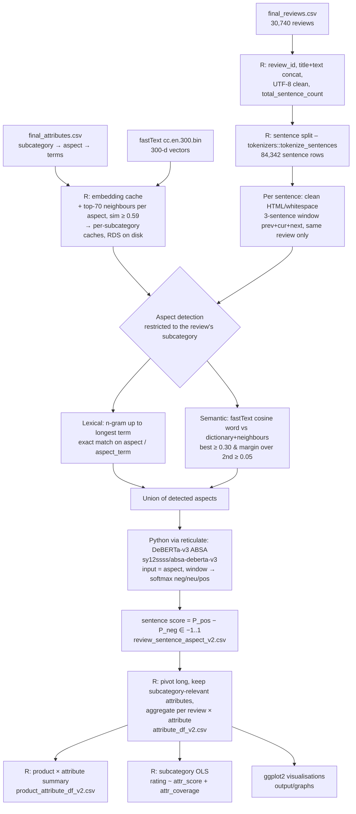

# Report Notes – Methodology, System Architecture, Results & Analysis

All numbers below come from the `_v2` outputs in `./output` (latest full run) and `datasets/final_reviews.csv`.
Subcategory regression is reproduced by `processing/subcategory_regression.R`; results saved to
`output/subcategory_regression_summary_v2.csv` and `output/subcategory_regression_coefficients_v2.csv`.

---

## 1. Problem & Objective

- Star rating = one number; hides *which* product attributes drive satisfaction.
- Goal: extract attribute-level (aspect-level) sentiment from free-text Amazon electronics reviews at scale, then
  quantify how each attribute's sentiment and how much a review talks about it explain the user's star rating —
  separately per product subcategory (attributes that matter for headphones ≠ cables ≠ protection cases).
- Two outputs: (a) **consumer/manager view** – product × attribute sentiment table; (b) **explanatory view** –
  subcategory regressions of rating on attribute score + attribute coverage.

---

## 2. Data

| Item | Value |
|---|---|
| Source | Amazon Reviews (Electronics), sampled – `datasets/final_reviews.csv` |
| Reviews | 30,740 (30,738 survive sentence split) |
| Distinct products (ASIN) | 17,452 |
| Subcategories | 22 (protection 6,007 … specialized 84) |
| Fields | asin, helpful_vote, rating, text, title, verified_purchase, metadata_average_rating, metadata_rating_number, subcategory |
| Rating distribution | 1★ 2,818 · 2★ 1,155 · 3★ 1,612 · 4★ 3,227 · 5★ 21,928 (71% five-star → strong positive skew) |
| Verified purchases | 96.4% |
| Helpful votes | median 0, mean 0.53, max 506 |
| Sentences (title + text) | 84,342 |
| Attribute dictionary | `datasets/final_attributes.csv` – 1,528 rows: (subcategory, aspect, aspect_term); 60 canonical attributes; each subcategory has its own ~6–8 attribute subset |

Subcategory sizes: protection 6,007 · audio 3,222 · cables 3,150 · headphones 2,778 · media 1,806 · photography 1,795 ·
displays 1,640 · storage 1,157 · power 1,089 · mobile 1,050 · security 1,041 · mounts 962 · networking 850 ·
peripherals 849 · components 663 · wearables 648 · computers 627 · smarthome 619 · automotive 407 · optics 164 ·
warranties 132 · specialized 84.

---

## 3. System Architecture

### Component / technology table

| Layer | Component | Tech | File |
|---|---|---|---|
| Config | packages, model IDs, paths, thresholds, feature flags | R | `constants.R` |
| Environment | R packages; Python venv `absa-env` (torch, transformers) | R + reticulate | `setup.R` |
| Ingestion | load reviews + attribute dictionary | R `read.csv` | `setup.R` |
| Pre-processing | review_id, encoding fix, sentence count, sentence split | dplyr, tidyr, tokenizers | `utils.R`, `processing/text_processing.R` |
| Aspect detection – lexical | n-gram generation (stopword unigrams removed), exact dictionary match | base R | `processing/text_processing.R` |
| Aspect detection – semantic | fastText vectors, nearest-neighbour expansion, cosine + margin rule | fastTextR | `processing/semantic_matching.R` |
| Caching | embedding matrix + neighbour map persisted as `.rds`; per-subcategory sub-matrices built once | saveRDS | `processing/semantic_matching.R` |
| Sentiment | aspect-conditioned DeBERTa-v3 sequence-pair classifier, no-grad inference, max 256 tokens | Python (pretrained only) via reticulate | `models/bert_sentiments.R` |
| Aggregation | sentence → review×attribute → product×attribute | dplyr | `utils.R`, `main.R` |
| Modelling | per-subcategory OLS | `lm` | `processing/subcategory_regression.R` |
| Visualisation | bar/box plots | ggplot2 | `processing/visualizations.R` |
| Logging | timestamped log | base R | `utils.R` → `output/log_dump.txt` |

### Big-data design choices (worth stating in report)

- **Compute once, reuse**: fastText model (~7 GB) loaded once; dictionary + neighbour embeddings pre-computed,
  L2-normalised, cached to disk → similarity = one matrix multiply (`word_matrix %*% t(dictionary_vectors)`).
- **Search-space pruning by subcategory**: each sentence compared only against its subcategory's 6–8 attributes,
  not all 60 → fewer false positives and fewer model calls.
- **Model calls only where needed**: DeBERTa runs only on (sentence, detected aspect) pairs, not on every
  sentence × every aspect (~73% of sentences had ≥1 aspect; 27% skipped entirely).
- **Model loaded once**; inference under `torch.no_grad()`; truncation at 256 tokens.
- **Wide → long reshaping** (84k sentence rows × 60 attribute cols → 218k review×attribute rows → 124k
  product×attribute rows) keeps each stage a tidy, joinable table.
- **Course constraint**: everything R; Python only for pretrained transformer inference.

---

## 4. Methodology (step by step)

1. **Review preparation** – assign `review_id`; concatenate `title + text` (titles carry strong sentiment, e.g.
   "So easy to use"); drop invalid UTF-8; count sentences → `total_sentence_count`.
2. **Sentence segmentation** – `tokenizers::tokenize_sentences`; one row per sentence; order preserved.
3. **Context window** – for sentence *i*: previous + current + next sentence, only if they belong to the same review.
   Keeps negation/contrast and pronoun references ("It barely lasts until lunch") without clause-cutting.
   Detection runs on the *current* sentence; sentiment is scored on the *window*.
4. **Attribute dictionary** – curated subcategory → aspect → aspect_term list (e.g. protection/fit: "snug fit",
   "fits the device"). 60 canonical attributes across 22 subcategories.
5. **Dictionary expansion (fastText)** – for each aspect, 70 nearest neighbours from 300-d Common-Crawl fastText;
   keep those with cosine ≥ 0.59 → extra synonyms (handles misspellings/sub-words since fastText uses char n-grams).
6. **Lexical detection** – generate 1..n-grams (n = longest dictionary phrase), drop stop-word unigrams,
   exact match against aspect names and terms of the review's subcategory.
7. **Semantic detection** – each non-stopword word (minus a generic-word blacklist: good, great, product, item …)
   embedded with fastText; cosine vs every dictionary/neighbour vector; attribute score = max similarity over its
   terms; accept top attribute if **similarity ≥ 0.30 and margin over 2nd-best ≥ 0.05** (competitive matching
   prevents ambiguous words being assigned).
8. **Aspect set** = union(lexical, semantic).
9. **Aspect-based sentiment** – pretrained `sy12ssss/absa-deberta-v3`; input pair `[aspect] [SEP] [window]`;
   softmax → P(neg), P(neu), P(pos). **Sentiment score = P(pos) − P(neg)**, range −1…+1 (neutral ≈ 0).
10. **Review-level aggregation** (per review × attribute, only attributes valid for that subcategory):
    - `attribute_score` = mean sentence score (NA if not mentioned)
    - `attribute_count` = # sentences mentioning attribute
    - `attribute_coverage` = attribute_count / total_sentence_count (share of review devoted to the attribute)
11. **Product-level aggregation** – per product × attribute: mean sentiment, # positive / neutral / negative reviews,
    total reviews.
12. **Subcategory regression** (one OLS per subcategory, 22 models):

    rating = β0 + Σ_a β_a·score_a + Σ_a γ_a·coverage_a + ε

    - dependent: user star rating (1–5)
    - independents: score and coverage for every attribute belonging to that subcategory
    - unmentioned attribute → score = 0 (neutral), coverage = 0; attributes never mentioned in a subcategory dropped
    - fit: R², adjusted R², F-test; coefficient t-tests at α = 0.05
13. **Pooled benchmark** – rating ~ mean attribute score + # attributes discussed + total coverage + subcategory
    fixed effects (all 30,738 reviews).

---

## 5. Results

### 5.1 Pipeline output volumes

| Stage | Rows |
|---|---|
| Reviews | 30,738 |
| Sentences | 84,342 |
| Sentences with ≥1 attribute | 61,422 (72.8%) |
| Sentences with 1 / 2 / 3 / 4+ attributes | 30,108 / 19,511 / 8,294 / 3,509 |
| Review × attribute rows (`attribute_df_v2`) | 218,397 |
| Review × attribute mentions (count > 0) | 68,013 |
| Reviews with ≥1 attribute detected | 26,405 (85.9%) |
| Product × attribute rows (`product_attribute_df_v2`) | 124,110 (17,451 products) |

### 5.2 Attribute sentiment (descriptive)

- Mentions: mean score 0.40, median 0.97 → **bimodal**: model is confident; 71.1% positive, 28.9% negative.
- Mention depth: median 1 sentence (mean 1.6); median coverage 0.50 of the review.

Most-discussed attributes:

| Attribute | Mentions | Mean score | % negative |
|---|---|---|---|
| build | 7,131 | 0.48 | 24.1 |
| durability | 7,099 | 0.55 | 21.7 |
| fit | 5,650 | 0.44 | 27.3 |
| sound | 5,571 | 0.47 | 25.6 |
| battery | 3,159 | 0.30 | 33.6 |
| connectivity | 3,146 | 0.18 | 39.7 |
| compatibility | 2,816 | 0.28 | 34.8 |
| design | 2,363 | 0.59 | 20.2 |
| charging | 2,295 | 0.37 | 30.3 |
| comfort | 2,291 | 0.74 | 12.3 |

Pain points (net-negative attributes): noise −0.15 (58% neg), detection −0.08, cost −0.07, claims −0.07, heat 0.01,
alerts 0.03 → security cameras (detection/alerts), warranties (claims/cost), components (noise/heat).

### 5.3 Attributes vs rating (descriptive)

Mean rating by # attributes discussed: 0 → 4.60 · 1 → 4.41 · 2 → 4.30 · 3 → 4.21 · 4 → 4.14 · 5 → 4.10 · 6 → 3.98 · 7 → 3.85.
**More attributes discussed → lower rating** (unhappy customers write detailed, multi-aspect reviews).

Rating distribution by review mean attribute score:

| Mean score bin | 1★ | 2★ | 3★ | 4★ | 5★ |
|---|---|---|---|---|---|
| (−1, −0.5] | 46% | 18% | 18% | 10% | 8% |
| (−0.5, 0] | 6% | 3% | 7% | 13% | 71% |
| (0, 0.5] | 2% | 2% | 7% | 24% | 65% |
| (0.5, 1] | 0% | 0% | 1% | 8% | 91% |

### 5.4 Pooled regression (n = 30,738, subcategory fixed effects)

| Term | β | p |
|---|---|---|
| intercept | 4.109 | <0.001 |
| mean attribute score | **+1.294** | <0.001 |
| # attributes discussed | −0.038 | <0.001 |
| total coverage | −0.129 | <0.001 |

R² = 0.549, adj R² = 0.548.

### 5.5 Subcategory regressions (rating ~ attribute scores + coverages)

All 22 models significant (F-test p < 0.001).

| Subcategory | n | predictors | R² | adj R² | mean rating |
|---|---|---|---|---|---|
| computers | 627 | 14 | 0.614 | 0.606 | 4.19 |
| specialized | 84 | 12 | 0.644 | 0.583 | 3.77 |
| warranties | 132 | 12 | 0.611 | 0.572 | 3.94 |
| cables | 3,149 | 14 | 0.559 | 0.558 | 4.27 |
| peripherals | 849 | 14 | 0.558 | 0.551 | 4.18 |
| headphones | 2,778 | 16 | 0.550 | 0.547 | 4.13 |
| displays | 1,640 | 14 | 0.536 | 0.532 | 4.22 |
| optics | 164 | 12 | 0.553 | 0.518 | 4.32 |
| mobile | 1,050 | 14 | 0.520 | 0.514 | 4.32 |
| power | 1,089 | 14 | 0.517 | 0.511 | 4.33 |
| mounts | 962 | 12 | 0.507 | 0.500 | 4.43 |
| protection | 6,006 | 14 | 0.496 | 0.495 | 4.37 |
| wearables | 648 | 14 | 0.504 | 0.493 | 4.18 |
| photography | 1,795 | 16 | 0.496 | 0.492 | 4.32 |
| automotive | 407 | 14 | 0.504 | 0.486 | 4.06 |
| audio | 3,222 | 14 | 0.483 | 0.481 | 4.52 |
| security | 1,041 | 14 | 0.485 | 0.478 | 4.14 |
| components | 663 | 14 | 0.486 | 0.475 | 4.38 |
| networking | 850 | 14 | 0.458 | 0.449 | 4.14 |
| media | 1,806 | 14 | 0.402 | 0.397 | 4.37 |
| smarthome | 619 | 14 | 0.408 | 0.395 | 4.49 |
| storage | 1,157 | 14 | 0.356 | 0.348 | 4.39 |

Coefficient summary (304 coefficients = 152 score + 152 coverage):

- **Score**: 109 / 152 significant; 108 of them positive (only exception: optics/usability −0.54, n = 164).
- **Coverage**: 68 / 152 significant; 64 negative (positive exceptions: protection/comfort, peripherals/comfort,
  optics/usability, cables/durability).

Key driver per subcategory (largest significant score β = rating gain moving that attribute from neutral (0) to fully positive (+1)):

| Subcategory | Top driver(s) β |
|---|---|
| power | charging 1.08 |
| peripherals / computers / mounts / mobile / displays / components | build 1.10 / 1.06 / 1.04 / 0.96 / 0.94 / 0.89 |
| networking | setup 0.87 |
| warranties | replacement 0.84, service 0.70 |
| headphones | sound 0.80, durability 0.42 |
| protection | fit 0.76, durability 0.44 |
| cables | fit 0.73, charging 0.67 |
| automotive | sound 0.71, display 0.58 |
| smarthome | controls 0.70, installation 0.63 |
| security | image 0.66, installation 0.60 |
| storage | durability 0.64, compatibility 0.60 |
| wearables | display 0.64, battery 0.58 |
| media | controls 0.58, playback 0.56 |
| optics | build 0.87, magnification 0.74 |
| audio | build 0.65, sound 0.59 |
| photography | build 0.63, focus 0.45 |

(Full table: `output/subcategory_regression_coefficients_v2.csv`.)

---

## 6. Analysis / Interpretation

1. **Aspect sentiment explains ~35–61% of rating variance** inside each subcategory using only 12–16 text-derived
   features — strong for noisy, 5-star-skewed review data. Highest for computers/peripherals/cables (concrete,
   functional attributes); lowest for storage/smarthome/media (failures often unrelated to dictionary attributes,
   e.g. dead-on-arrival, returns, seller issues).
2. **Sentiment direction matters, as expected**: almost every significant score coefficient is positive.
3. **Coverage is negative given sentiment**: holding attribute sentiment fixed, spending a larger share of the review
   on an attribute lowers the rating → customers elaborate on problems, not on things that just work
   ("negativity/elaboration effect"). Consistent with the descriptive finding that rating falls as # attributes
   discussed rises. Exceptions (comfort in protection/peripherals) = attributes praised at length.
4. **Drivers differ by subcategory** → justifies subcategory-specific dictionaries and models: charging for power
   banks, fit for cases/cables, sound for headphones, setup for networking, replacement/service for warranties;
   "build" (overall build quality) is the dominant generic driver for hardware-heavy subcategories.
5. **Managerial view** (`product_attribute_df_v2`): per product × attribute counts of positive/neutral/negative
   reviews pinpoint concrete defects (e.g. a security camera with 36/45 negative mentions on one attribute) that
   a star average would hide.

---

## 7. Limitations (for report)

- **Rating skew** (71% 5★) – OLS on an ordinal 1–5 target; ordered logit is a natural robustness check.
- **Score/coverage coupling** – coverage > 0 exactly when the attribute is mentioned; coefficients should be read
  jointly (non-mentioned → 0/0). Interaction or mention-dummy specification is a possible extension.
- **No ground-truth labels** – aspect detection and ABSA not validated against annotated sample (README validation
  plan not yet executed); thresholds (0.59 neighbour, 0.30 similarity, 0.05 margin) chosen heuristically.
- **Window overlap** – adjacent sentences share context; repeated evidence is averaged, not de-duplicated.
- **Generic attributes** – "build" absorbs general quality words → large coefficients partly reflect overall sentiment.
- **Small subcategories** (specialized 84, warranties 132, optics 164) – higher adj-R² gap, unstable coefficients.
- Single run on a sample (30.7k reviews); runtime dominated by sequential per-sentence transformer calls.
- `ENABLE_REGRESSION` block in `main.R` references an older `final_df`/`overall_sentiment` schema and is disabled;
  subcategory regression lives in `processing/subcategory_regression.R`.
