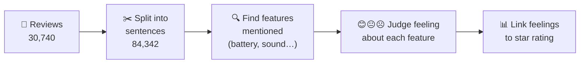
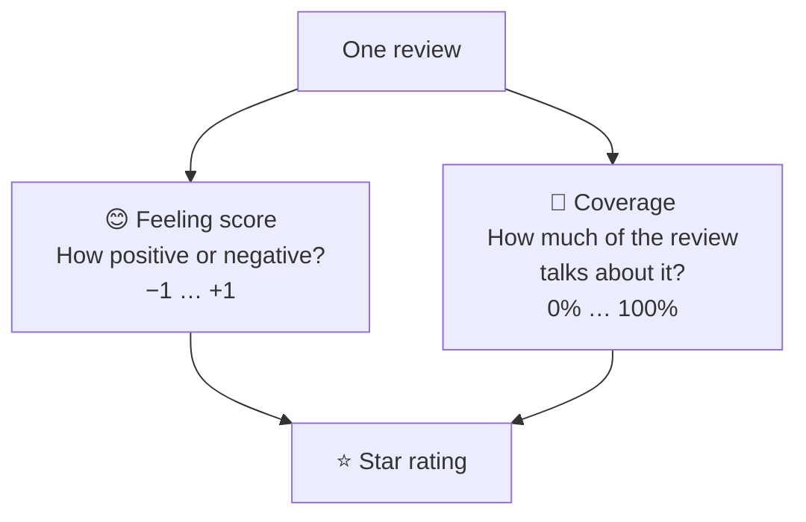
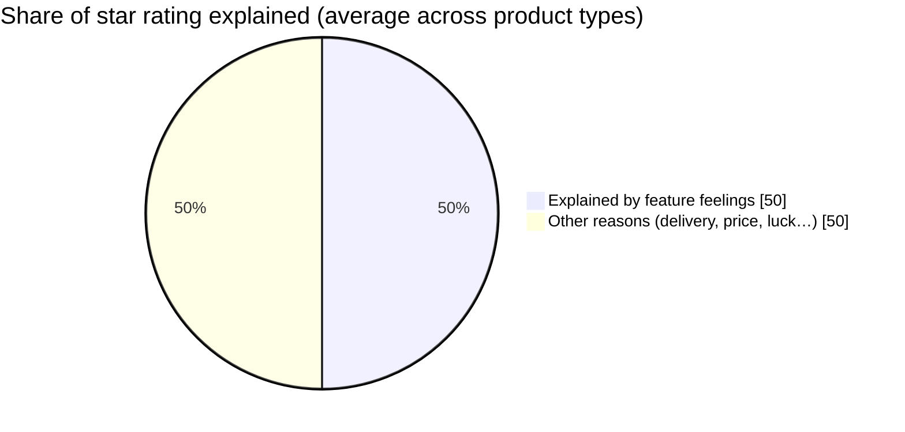
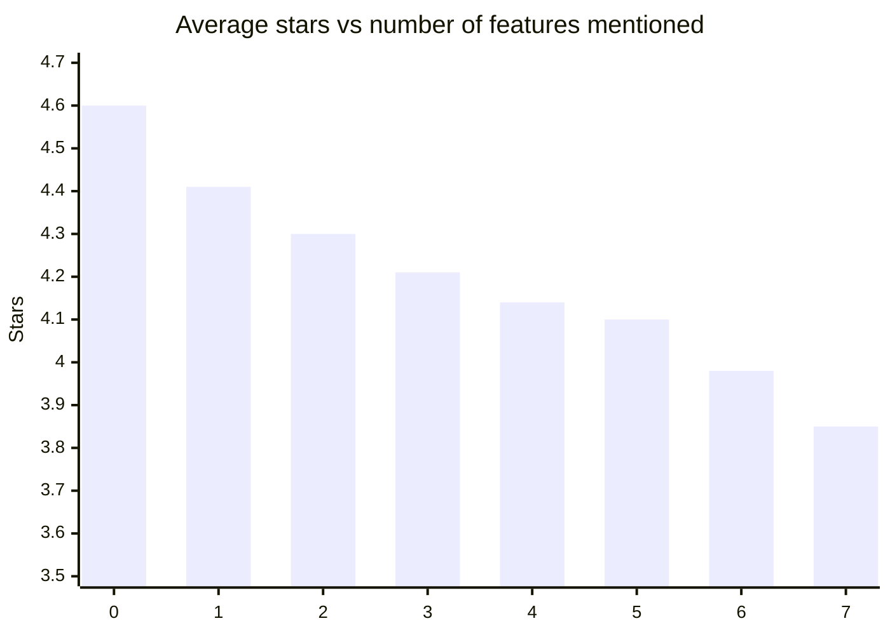

# Project Brief – What Do Customers Actually Care About?

## The question

A star rating only says *how happy* a customer is. It doesn't say *why*.
We read **30,740 Amazon electronics reviews** automatically and asked:

> Which product features (battery, sound, fit, build quality…) push the star rating up or down — and does it differ by product type?

---

## How it works – in 5 steps

| Step | What happens | Simple example |
|---|---|---|
| 1. Collect | Reviews grouped into 22 product types (headphones, cables, phone cases…) | "Headphones" review |
| 2. Split | Each review broken into sentences | "Sound is amazing. Battery dies in 2 hours." |
| 3. Find features | Computer spots feature words using a feature list **plus** similar words it learned (e.g. "audio" ≈ "sound") | Sound ✔ Battery ✔ |
| 4. Judge feeling | An AI reads the sentence (and its neighbours for context) and scores each feature from **−1 (hate)** to **+1 (love)** | Sound **+0.99**, Battery **−0.97** |
| 5. Compare to stars | For each product type, measure how much each feature's feeling moves the star rating | Sound matters a lot for headphones |

---

## Two things we measure per feature in each review

---

## What we found

### 1. Feelings about features explain about half of the star rating

Range: **35%** (storage) to **61%** (computers).

### 2. Positive feeling = higher stars (no surprise, but confirmed)

| Average feeling in review | Gave 5 stars | Gave 1 star |
|---|---|---|
| Very negative | 8% | 46% |
| Very positive | 91% | 0% |

### 3. Talking *more* about a feature usually means a problem

People write long when something is wrong. The more features a review mentions, the lower the rating:

### 4. What matters most depends on the product

| Product type | #1 thing customers care about |
|---|---|
| Power banks / chargers | Charging |
| Phone cases | Fit |
| Cables | Fit & charging |
| Headphones | Sound |
| Computers, keyboards/mice, mounts, phones, monitors | Build quality |
| Wi-Fi / networking | Easy setup |
| Smart home | Controls & installation |
| Security cameras | Image quality |
| Warranties | Replacement & service |
| Smartwatches | Display & battery |

### 5. Most-complained-about features

- **Noise** (fans, hum) – more negative than positive
- **Motion detection & alerts** (security cameras)
- **Claims & cost** (warranties)
- **Connectivity** (Bluetooth/Wi-Fi) – 40% of mentions negative

---

## Why it's useful

- **For shoppers:** see per-feature scores, not just one star average.
- **For sellers / managers:** know *exactly* which feature to fix per product type (e.g. fix charging for power banks, not design).
- **At scale:** fully automatic — works on tens of thousands of reviews without anyone reading them.

## Honest limits

- Most reviews are 5 stars (71%), so bad experiences are a smaller sample.
- No human double-checked the AI's labels yet.
- Small product groups (warranties, optics, specialized) give less reliable results.
- "Build quality" is broad and sometimes catches general praise.
