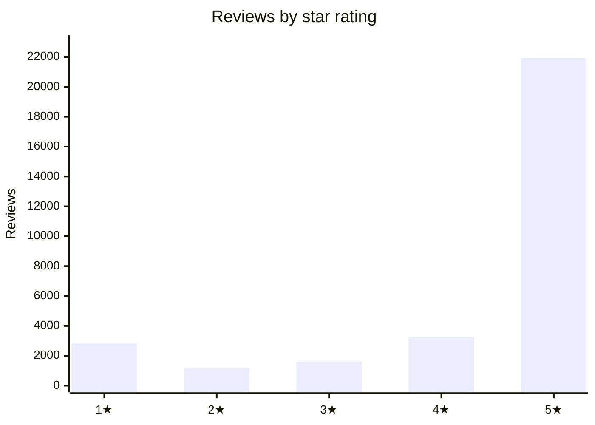
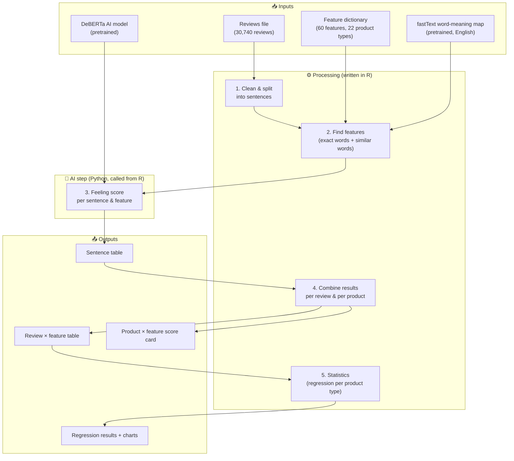
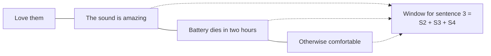
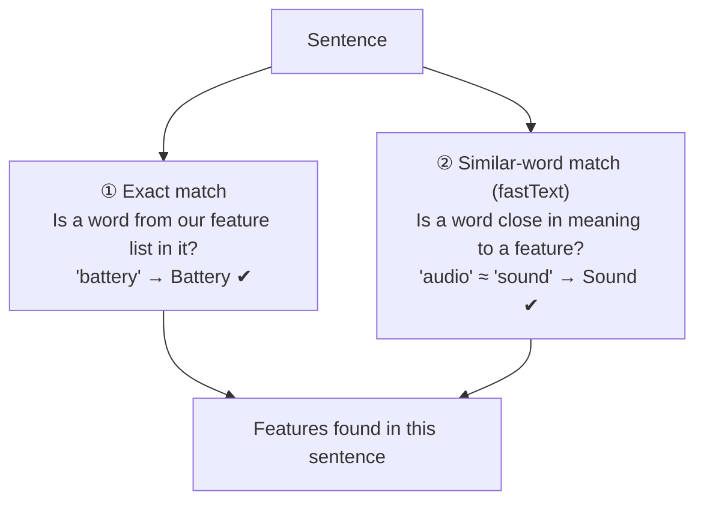
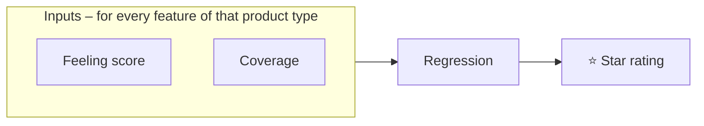
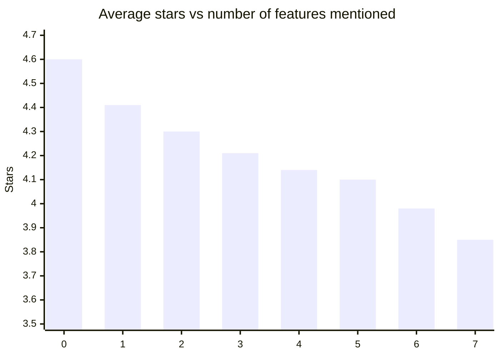

# Team Guide – What We Did, How, and What We Found

Plain-language guide for writing the report. Each part maps to a report section:
**Introduction → Data → System Architecture → Methodology → Results → Analysis → Limitations.**
Technical detail (exact settings, full tables) lives in `REPORT_NOTES.md`.

---

## 0. Words you'll need (glossary)

| Term | Plain meaning |
|---|---|
| **Review** | One customer's written opinion + star rating (1–5) |
| **Subcategory** | Product type, e.g. headphones, cables, phone cases (22 in total) |
| **Attribute / aspect** | A product feature people talk about: battery, sound, fit, build quality… |
| **Attribute dictionary** | Our hand-made list: for each product type, its features and the words people use for them (e.g. *fit* → "snug fit", "fits the device") |
| **ABSA** (Aspect-Based Sentiment Analysis) | Finding the feeling about **each feature**, not the whole review. "Great sound, awful battery" = sound 😊, battery ☹️ |
| **Word embeddings (fastText)** | A pretrained "word meaning map" where similar words sit close together ("audio" near "sound"). Used to catch features even when our list doesn't have the exact word |
| **Cosine similarity** | How close two words are on that map (0 = unrelated, 1 = same meaning) |
| **DeBERTa** | A pretrained AI language model (BERT family). We gave it a sentence + a feature name; it says positive / neutral / negative |
| **Sentiment score** | P(positive) − P(negative). Ranges **−1 (very negative) to +1 (very positive)** |
| **Coverage** | Share of a review's sentences about a feature. 1 of 4 sentences → 25% |
| **Regression (OLS)** | A statistical method that measures how much each input moves an outcome (here: star rating) |
| **Coefficient (β)** | The size of that effect. β = 0.8 for sound → going from neutral to fully positive about sound adds ~0.8 stars |
| **R²** | How much of the star rating the model explains (0.5 = 50%) |
| **p-value < 0.05** | The effect is statistically reliable, not chance |

---

## 1. Introduction – the problem

- A star rating tells **how** happy a customer is, not **why**.
- Thousands of reviews → nobody can read them all.
- **Goal:** automatically read reviews, find which features are discussed, judge the feeling about each, and measure which features actually drive the star rating — **separately for each product type**, because what matters for headphones (sound) isn't what matters for phone cases (fit).

**Two audiences:**
1. **Shoppers / managers** → per-product, per-feature score card.
2. **Analysis** → which features explain star ratings, per product type.

---

## 2. Data

| What | Value |
|---|---|
| Source | Amazon Electronics reviews (sample) |
| Reviews | 30,740 |
| Products | 17,452 |
| Product types | 22 |
| Info per review | product ID, star rating, title, text, helpful votes, verified purchase, product type |
| Feature list | 60 features, 1,528 feature words, each product type has its own 6–8 features |

**Important fact:** 71% of reviews are 5 stars → data is very positive-heavy.

Biggest product types: phone cases/protection 6,007 · audio 3,222 · cables 3,150 · headphones 2,778.
Smallest: optics 164 · warranties 132 · specialized 84.

---

## 3. System Architecture – the building blocks

Think of it as an **assembly line**: each station takes a table in, does one job, and passes a new table on.

| Block | Job | Tool |
|---|---|---|
| Setup | Load libraries, connect R to Python, load data | R (`setup.R`) |
| Text processing | Clean text, split into sentences | R (`tokenizers`) |
| Feature finder | Match feature words; use word-meaning map for similar words | R (`fastTextR`) |
| Sentiment AI | Score feeling per feature | Pretrained DeBERTa via Python (`reticulate`) |
| Combiner | Roll sentence results up to review, then product | R (`dplyr`) |
| Statistics | Regression per product type | R (`lm`) |
| Charts | Bar / box plots | R (`ggplot2`) |

**Why R + Python?** Course rule: everything in R; Python allowed only to run a pretrained BERT-type model.

### Big-data / efficiency choices (good to mention)

| Choice | Why it matters |
|---|---|
| Load the big models **once** | fastText map is several GB; reloading per review would be impossible |
| **Save pre-computed word vectors to disk** (cache) | Second run starts instantly; comparison = one fast matrix calculation |
| **Only check features of that product type** | A cable review is checked for 6–8 cable features, not all 60 → faster, fewer mistakes |
| **Call the AI only when a feature is found** | 27% of sentences had no feature → skipped, saving time |
| **Tidy tables at each stage** | Easy to join, re-use, and audit |

---

## 4. Methodology – step by step (with one worked example)

**Example review (headphones) – illustrative, numbers made up to explain the steps:**
> *Title:* "Love them" · *Text:* "The sound is amazing. Battery dies in two hours. Otherwise comfortable."  · ⭐ 4

### Step 1 – Prepare the text
- Join title + text (titles carry strong feelings).
- Remove junk characters / HTML.
- Split into sentences → **4 sentences**: "Love them" / "The sound is amazing" / "Battery dies in two hours" / "Otherwise comfortable".

### Step 2 – Look at neighbours for context
Each sentence is read **together with the sentence before and after** (same review only).
Why: "It dies in two hours" only makes sense if you know "it" = battery.

### Step 3 – Find features (two ways)

- **Exact match:** words and short phrases ("battery life", "snug fit") checked against the dictionary of *that product type*.
- **Similar-word match:** each meaningful word (common words like "the", "good", "product" ignored) compared to every feature word.
  Accepted only if it is **clearly close (≥ 0.30)** **and clearly closer to one feature than the next best (gap ≥ 0.05)** — avoids guessing when a word fits two features.
- The dictionary was also **auto-expanded**: for each feature we added its 70 closest words from the meaning map (kept only very close ones, ≥ 0.59).

Example result: S2 → Sound, S3 → Battery, S4 → Comfort.

### Step 4 – Judge the feeling (AI)
For each (sentence window, feature) pair, DeBERTa returns 3 probabilities. Score = positive − negative.

| Sentence | Feature | Positive | Negative | **Score** |
|---|---|---|---|---|
| The sound is amazing | Sound | 0.99 | 0.00 | **+0.99** |
| Battery dies in two hours | Battery | 0.01 | 0.98 | **−0.97** |
| Otherwise comfortable | Comfort | 0.97 | 0.01 | **+0.96** |

### Step 5 – Combine per review
For each feature in the review:
- **Feeling score** = average of its sentence scores
- **Coverage** = sentences about it ÷ total sentences

| Feature | Score | Coverage |
|---|---|---|
| Sound | +0.99 | 1/4 = 25% |
| Battery | −0.97 | 25% |
| Comfort | +0.96 | 25% |
| Noise (not mentioned) | 0 (treated as neutral) | 0% |

### Step 6 – Combine per product (score card)
For each product × feature: average feeling, number of positive / neutral / negative reviews.
→ Lets a manager see e.g. "this camera: 36 of 45 reviews negative on detection".

### Step 7 – Statistics: what drives the star rating?
One regression **per product type** (22 models):

- **Outcome (dependent):** customer's star rating.
- **Inputs (independent):** feeling score + coverage for each feature of that product type.
- Gives: how much each feature moves the stars (β), whether it's reliable (p-value), how much is explained overall (R²).
- Plus one **overall model** across all reviews as a benchmark.

---

## 5. Results – numbers to quote

### 5.1 How much the system found
| | |
|---|---|
| Sentences processed | 84,342 |
| Sentences with ≥1 feature | 61,422 (**73%**) |
| Reviews with ≥1 feature | 26,405 (**86%**) |
| Feature mentions scored | 68,013 |
| Of those: positive / negative | **71% / 29%** |

### 5.2 Most-discussed features
| Feature | Mentions | Avg feeling | % negative |
|---|---|---|---|
| Build quality | 7,131 | +0.48 | 24% |
| Durability | 7,099 | +0.55 | 22% |
| Fit | 5,650 | +0.44 | 27% |
| Sound | 5,571 | +0.47 | 26% |
| Battery | 3,159 | +0.30 | 34% |
| Connectivity | 3,146 | +0.18 | 40% |
| Comfort | 2,291 | +0.74 | 12% |

**Most complained about:** noise (58% negative), motion detection, warranty claims & cost, heat, alerts.

### 5.3 Feeling vs stars
| Avg feeling in review | 1★ | 5★ |
|---|---|---|
| Very negative | 46% | 8% |
| Very positive | 0% | 91% |

### 5.4 More features mentioned → lower stars

### 5.5 Regression – how well features explain stars
- **All 22 models statistically significant.**
- Explained share of star rating (R²): **35% (storage) → 61% (computers)**, average **~50%**.
- Overall model (all reviews): R² **55%**; average feeling coefficient **+1.29 stars**.

| Product type | Explained (adj R²) |
|---|---|
| Computers | 61% |
| Cables | 56% |
| Headphones | 55% |
| Displays | 53% |
| Phone cases / protection | 50% |
| Audio | 48% |
| Smart home | 40% |
| Storage | 35% |

### 5.6 Top driver per product type
| Product type | Feature that moves stars most | Effect (stars, neutral → fully positive) |
|---|---|---|
| Power banks / chargers | Charging | +1.08 |
| Keyboards & mice | Build | +1.10 |
| Computers | Build | +1.06 |
| Mounts | Build | +1.04 |
| Phones | Build | +0.96 |
| Networking | Setup | +0.87 |
| Warranties | Replacement | +0.84 |
| Headphones | Sound | +0.80 |
| Phone cases | Fit | +0.76 |
| Cables | Fit | +0.73 |
| Smart home | Controls | +0.70 |
| Security cameras | Image | +0.66 |
| Storage | Durability | +0.64 |
| Smartwatches | Display | +0.64 |

---

## 6. Analysis – what it means (suggested wording)

1. **Feature feelings explain about half of why customers give the stars they do** — using only what they wrote. The rest is things like delivery, price, seller issues, or defects not tied to a listed feature.
2. **Positive feelings raise stars, almost without exception** — 108 of 109 reliable feeling effects are positive. This shows the method is measuring something real.
3. **Writing more about a feature = bad news.** Holding the feeling constant, the more of a review is spent on a feature, the lower the stars (64 of 68 reliable coverage effects are negative). Unhappy customers explain in detail; happy ones say "works great". Exception: **comfort** — people praise comfort at length.
4. **Every product type has different priorities** — charging for power banks, fit for cases, sound for headphones, setup for routers. One general model would miss this; per-type models catch it.
5. **Practical use:** sellers can target the one feature that moves their stars most; shoppers get per-feature score cards instead of one average.

---

## 7. Limitations (be honest in the report)

- 71% five-star reviews → fewer examples of unhappy customers.
- No human checked a sample of the AI's labels yet (accuracy not measured).
- Thresholds (0.30, 0.05, 0.59) set by judgement, not tuned on labelled data.
- "Build quality" is broad and sometimes catches general praise → its effect may be inflated.
- Feeling score and coverage are linked (both zero if not mentioned) → read them together.
- Small product types (specialized 84, warranties 132, optics 164) → less reliable.
- Star rating is 1–5 steps; a model designed for ranked outcomes (ordered logit) would be a good check.

**Future work:** human-labelled test set, tune thresholds, ordered-logit model, add price/delivery info, run on full dataset.

---

## 8. Where things are (for reference)

| File | What it is |
|---|---|
| `main.R` | Runs the whole pipeline |
| `setup.R`, `constants.R` | Setup and settings |
| `processing/text_processing.R` | Sentence split, exact feature matching |
| `processing/semantic_matching.R` | Similar-word matching (fastText) |
| `models/bert_sentiments.R` | AI feeling score (DeBERTa) |
| `processing/subcategory_regression.R` | Regression per product type |
| `processing/visualizations.R` | Charts |
| `datasets/final_reviews.csv` | Input reviews |
| `datasets/final_attributes.csv` | Feature dictionary |
| `output/review_sentence_aspect_v2.csv` | Sentence-level results |
| `output/attribute_df_v2.csv` | Review × feature results |
| `output/product_attribute_df_v2.csv` | Product × feature score card |
| `output/subcategory_regression_summary_v2.csv` | Regression fit per product type |
| `output/subcategory_regression_coefficients_v2.csv` | Every feature's effect |
| `output/graphs/` | Charts |
